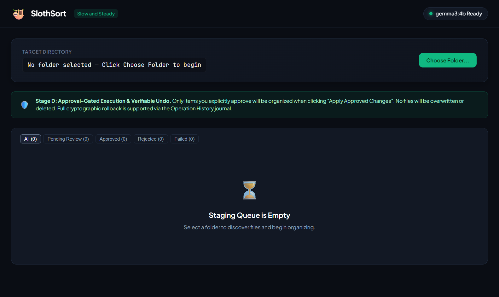
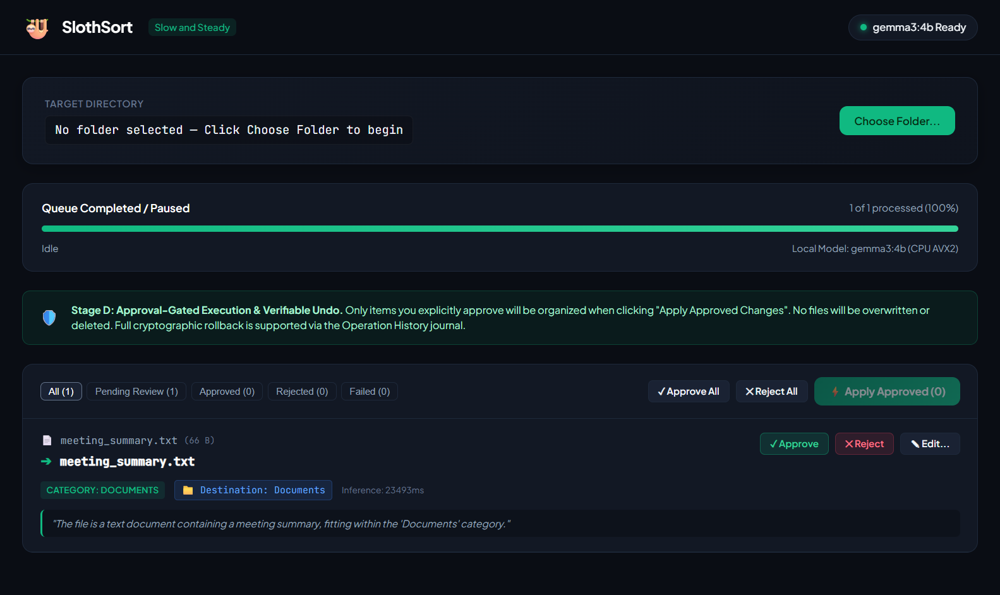
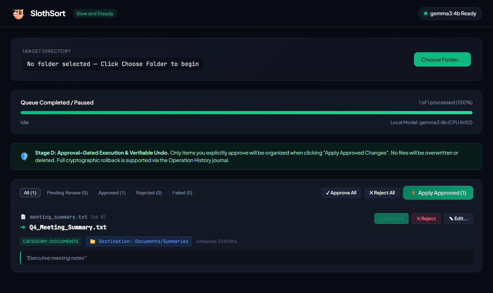
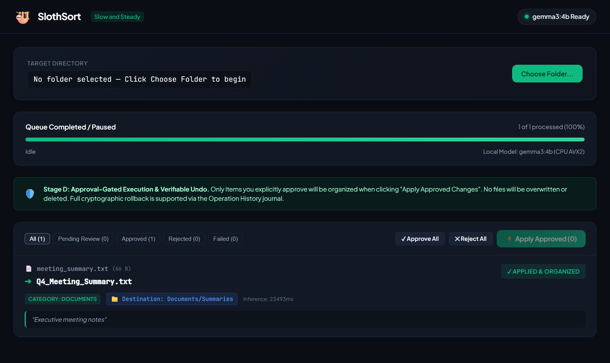
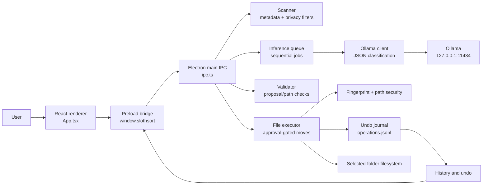

# SlothSort 🦥

> **Local AI suggestions for safer file organization.** SlothSort is a Windows desktop application that scans a selected folder, proposes categories, filenames, and destinations through local Ollama inference, and waits for your approval before moving anything.

[](https://github.com/Pranjal-debug/slothsort/releases/tag/v0.1.1)
[](LICENSE)

**15-second overview:** SlothSort turns a messy folder into a reviewable queue of file-organization proposals. The model runs through Ollama on the local machine, proposed moves are validated in the main process, and approved operations are recorded so supported moves can be undone.

## Start here

- **Repository:** [github.com/Pranjal-debug/slothsort](https://github.com/Pranjal-debug/slothsort)
- **Windows release:** [SlothSort v0.1.1](https://github.com/Pranjal-debug/slothsort/releases/tag/v0.1.1)
- **Direct ZIP download:** [SlothSort-v0.1.1-win-x64.zip](https://github.com/Pranjal-debug/slothsort/releases/download/v0.1.1/SlothSort-v0.1.1-win-x64.zip)
- **License:** [MIT](LICENSE)

> **Demo status:** The concise 1080p demo recording is prepared locally at `artifacts/day-2-audit/voiceover/SlothSort-v0.1.1-demo-video.mp4`, but it is not currently a tracked repository or public release asset. The README therefore uses the tracked screenshots below instead of linking an untracked binary.

## Why SlothSort?

Sorting files is easy to postpone and difficult to do safely in bulk. A plain AI-generated file list does not answer the operational questions that matter: **what will move, where will it go, what happens if the file changed, and how do I reverse the decision?**

SlothSort is deliberately organized around those questions:

- **Local inference:** the desktop client defaults to Ollama at `http://127.0.0.1:11434` with the `gemma3:4b` model. The application has no cloud AI provider integration in this workflow.
- **Human approval:** model output is an editable proposal, not an instruction. Nothing is executed until the user approves the current proposal.
- **Programmatic guardrails:** destinations and filenames are checked for absolute paths, traversal, illegal Windows characters, reserved device names, and root-boundary escapes.
- **Integrity-aware operations:** the executor checks a scan-time SHA-256 fingerprint, refuses destination collisions, records the operation, and verifies the moved file before removing the original path.
- **Recoverability:** operation history is persisted in JSONL, and supported moves can be undone when the destination still matches the recorded fingerprint and the original path is available.

## How it works

```text
Choose Folder
    │
    ▼
Metadata scan and privacy filtering
    │
    ▼
Sequential local Ollama analysis
    │
    ▼
Review, edit, approve, or reject proposals
    │
    ▼
Confirm and apply approved moves
    │
    ▼
Operation History ──► Undo supported moves
```

1. **Choose a folder.** The scanner walks the selected root without modifying files. It limits traversal to 500 files and a depth of 10.
2. **Scan safely.** Text-like files may contribute a bounded excerpt: the scanner reads at most 2,048 bytes and sends at most 500 characters. Sensitive filenames such as `.env`, private keys, credential stores, and browser login databases have excerpts suppressed. Ignored directories include `.git`, `node_modules`, `.ssh`, common browser-profile directories, and other system/configuration locations defined in `src/main/scanner.ts`.
3. **Analyze sequentially.** Each scanned file is queued one at a time for local Ollama inference. The model returns a category, suggested filename, relative destination, confidence, and reasoning in JSON.
4. **Review the proposal.** In **Staging & Review Queue**, inspect the category, destination, filename, reasoning, and status. Use **Approve**, **Reject**, or **Edit...**. Editing a proposal clears its previous approval signature; the edited proposal must be approved again.
5. **Apply approved changes.** **Apply Approved** opens a confirmation view. The main process revalidates the trusted queue state, approval binding, source fingerprint, path safety, and destination collision before executing.
6. **Inspect and undo.** **Operation History (Undo)** shows recorded operations. **Undo Move** verifies that the organized file was not changed and that the original location is free before restoring it.

## Screenshots

The following screenshots are tracked in the repository and come from the packaged Windows validation workflow.

| Launch and scan | Review proposals |
|---|---|
|  |  |

| Approval and execution | History and undo |
|---|---|
|  |  |

Additional tracked evidence shows the executed, undone, and relaunch-persistence states:

- [Executed operation](artifacts/phase-3b/screenshots/stage10_05_executed.png)
- [Undo completed](artifacts/phase-3b/screenshots/stage10_07_undone.png)
- [History after relaunch](artifacts/phase-3b/screenshots/stage10_08_relaunch_history.png)

## Privacy and security design

SlothSort is privacy-conscious by construction, not by an absolute “never communicates” promise. The relevant boundaries are visible in the source:

### Local AI workflow

- The desktop IPC layer creates `OllamaClient` with the default endpoint `http://127.0.0.1:11434`.
- Health checks use Ollama `/api/version`; model discovery uses `/api/tags`; classification uses `/api/generate` with a JSON response format.
- The default model is `gemma3:4b`. The model is **not bundled** with the Windows ZIP and must be installed separately through Ollama.
- Installing Ollama and downloading model weights requires an initial internet connection. During the demonstrated inference workflow, requests are sent to the local loopback Ollama service rather than a hosted AI API.

### Scanner data minimization

- Text excerpts are bounded and only attempted for a defined set of text-like extensions.
- Binary, media, archive, and unknown files are represented using metadata such as filename, extension, size, timestamps, MIME hint, and screenshot filename hint rather than extracted content.
- Sensitive files are marked and have `textExcerpt` suppressed. Browser-profile and system/configuration directories are skipped during traversal.

### Electron boundaries and operation controls

- The renderer runs with `contextIsolation: true` and `nodeIntegration: false`.
- The preload exposes a narrow `window.slothsort` bridge for folder selection, scanning, analysis, review, execution, history, and undo instead of exposing unrestricted Node.js APIs.
- IPC handlers validate payload shapes and route filesystem work through the main process.
- The main window denies `window.open` and blocks navigation away from local app content. The production renderer has no remote font resources; the packaged validation workflow checked for external renderer resources.
- Model output is treated as untrusted data. `src/validator.ts` validates categories, confidence values, filenames, and relative destinations before proposals enter trusted queue state.
- The executor checks source containment, symlink/junction escapes, scan-time SHA-256 fingerprints, stale approval signatures, destination collisions, and undo integrity.
- The journal stores operation intent and completion state in append-only JSONL records and reconciles interrupted operations or corrupt trailing lines without discarding valid history.

### What SlothSort does not guarantee

- SlothSort does not provide a general-purpose delete workflow. A successful organization is a move/rename: the source path is unlinked only after the destination has been verified. Undo is available for supported completed moves, subject to integrity and collision checks.
- Local inference does not mean the initial Ollama/model installation is offline.
- The application does not claim to secure the entire computer, prevent every external process from communicating, or guarantee perfect model classification.
- The packaged validation was performed on the target Windows development environment. A clean third-party Windows machine without developer tools was not available for that run.

## Installation for Windows users

The v0.1.1 release is a portable Windows x64 ZIP. The current packaging script produces an unpacked directory rather than an installer.

### 1. Install Ollama and the model

1. Install [Ollama for Windows](https://ollama.com/download/windows).
2. Open PowerShell or Command Prompt.
3. Download the required model:

   ```powershell
   ollama pull gemma3:4b
   ```

4. Confirm the model is available:

   ```powershell
   ollama list
   ```

The model is downloaded separately and may require several gigabytes of disk space. The repository does not pin or document a quantization variant; use the `gemma3:4b` tag shown above.

### 2. Download and launch SlothSort

1. Download [`SlothSort-v0.1.1-win-x64.zip`](https://github.com/Pranjal-debug/slothsort/releases/download/v0.1.1/SlothSort-v0.1.1-win-x64.zip) from the [v0.1.1 release page](https://github.com/Pranjal-debug/slothsort/releases/tag/v0.1.1).
2. Extract the ZIP to a folder you trust.
3. Launch `SlothSort.exe`.

The validated ZIP is approximately 158 MB and has SHA-256:

```text
9749092838b08d14641ecb483d893fd53224645a90cc54844b4959494b8b3f42
```

The Windows executable is unsigned and may trigger a Windows Defender SmartScreen “Unrecognized app” warning. Do not bypass warnings blindly: confirm that you downloaded the expected release and checksum first, then use **More info → Run anyway** only if you trust the artifact.

SlothSort was packaged and validated for Windows x64. Other operating systems are not promised by the v0.1.1 release.

## First-run usage guide

1. Start Ollama and confirm `gemma3:4b` appears in `ollama list`. SlothSort shows the model status in the top-right header.
2. Click **Choose Folder...** and select the folder to organize.
3. Review the **Discovered Files (Raw Metadata)** tab if you want to inspect filenames, relative paths, sizes, extensions, excerpts, and modified dates before analysis.
4. Click **Start AI Analysis**. The queue processes files sequentially and displays progress. **Cancel Queue** stops the active request and marks queued work as cancelled; failed or cancelled items can be retried.
5. In **Staging & Review Queue**, inspect each proposal. Use **Edit...** to change the filename, category, or relative destination folder. Use **Approve** or **Reject**; **Approve All** and **Reject All** are also available.
6. Click **Apply Approved**, review the confirmation table, then choose **Confirm & Apply All**. Only currently approved, not-yet-applied items are sent to the executor.
7. Open **Operation History (Undo)** to inspect completed moves, journal status, source/destination paths, and categories.
8. For a completed operation, click **Undo Move**. Undo refuses to overwrite an occupied original path or restore a destination whose contents no longer match the recorded fingerprint.

### Categories

The model prompt defines these seven categories:

| Category | Intended use |
|---|---|
| `Documents` | Reports, contracts, PDFs, spreadsheets, presentations, and text documents |
| `Images` | Photos and digital artwork, excluding UI screenshots |
| `Screenshots` | Screen captures and error-dialog captures; the scanner supplies a filename-based screenshot hint |
| `Projects` | Source code, package manifests, build scripts, and development files |
| `Installers` | Executable setup files, MSI packages, installers, and updater executables |
| `Archives` | Compressed containers and backup packages |
| `Other` | Audio, video, logs, empty/unknown, or otherwise unclassifiable files |

## Architecture

SlothSort is an Electron desktop app with a Vite-built React renderer and a TypeScript/Node.js main process.



### Main components

- `src/main/main.ts`: creates the `BrowserWindow`, enables the security-relevant web preferences, installs CSP/navigation protections, and loads the renderer.
- `src/main/preload.ts`: exposes the narrow typed bridge used by the renderer.
- `src/main/ipc.ts`: validates IPC requests and coordinates scanning, local inference, review state, execution, journal reads, and undo.
- `src/main/scanner.ts`: recursively scans within the selected root, applies depth/file limits, suppresses sensitive excerpts, and computes source fingerprints.
- `src/main/queue.ts`: runs one inference job at a time and tracks analysis/review state.
- `src/ollamaClient.ts`: talks to the local Ollama HTTP API and requests structured JSON output.
- `src/validator.ts`: validates model proposals against categories, confidence values, Windows filename rules, and relative destinations.
- `src/main/executor.ts`: revalidates approval and integrity conditions, performs same-volume or cross-volume moves, refuses overwrites, and handles undo.
- `src/main/journal.ts`: persists operation records and recovers from interrupted or truncated JSONL writes.
- `src/renderer/App.tsx`: implements folder selection, scan results, review/edit controls, execution confirmation, history, and undo UI.

## Development setup

### Prerequisites

- Node.js **22.12 or newer** for the current lockfile/toolchain.
- npm.
- Ollama with the `gemma3:4b` model for live inference and the offline verification command.
- Windows is the validated target for the packaged application. The source and deterministic tests may be run elsewhere, but the current shared workspace’s Linux/WSL dependency directory contains Windows-native packages, so Linux/WSL reproduction is not currently repeatable without reinstalling Linux-compatible dependencies.

### Install dependencies

```powershell
git clone https://github.com/Pranjal-debug/slothsort.git
cd slothsort
npm install
```

### Run the app from source

For a production-like local launch:

```powershell
npm run build
npm start
```

For renderer development with Vite hot reload, use two PowerShell terminals:

```powershell
# Terminal 1
npm run dev
```

```powershell
# Terminal 2
$env:VITE_DEV_SERVER_URL = "http://localhost:5173"
npm start
```

The Electron main process uses `http://127.0.0.1:11434` for Ollama in the desktop flow. From source, `SLOTHSORT_MODEL` can override the default model tag:

```powershell
$env:SLOTHSORT_MODEL = "gemma3:4b"
npm start
```

The journal defaults to `.slothsort/operations.jsonl` under the current user’s home directory. Maintainer/test runs can override its location with `SLOTHSORT_USER_DATA_DIR` or `SLOTHSORT_JOURNAL_PATH`.

### Build and package

```powershell
# Vite renderer + TypeScript main process
npm run build

# Windows x64 unpacked directory under dist/package/win-unpacked/
npm run package
```

The repository’s package script targets a Windows directory build (`electron-builder --win --dir`); it does not create an installer.

## Testing and verification

### Deterministic automated suites

The default `npm test` command runs six suites totaling **162 checks** on the validated Windows environment:

| Suite | Command | Current scope |
|---|---|---|
| Validator | `npm run test:validator` | Windows filename, destination, and model-output validation — 29 checks |
| Scanner | `npm run test:scanner` | Root containment, ignored directories, sensitive-file suppression, and scan metadata — 22 checks |
| Queue | `npm run test:queue` | Sequential inference queue and review state behavior — 22 checks |
| Executor | `npm run test:executor` | Approval contracts, moves, collisions, fingerprints, journal recovery, and undo — 40 checks |
| Release audit | `npm run test:audit` | End-to-end scan → analysis → approval → move → restart → undo and negative paths — 39 checks |
| Hardening | `npm run test:hardening` | Reparse-point boundaries, missing fingerprints, review validation, race handling, redaction, and packaging inputs — 10 checks |

Run them together with:

```powershell
npm test
```

The separate Windows/NTFS suite is **not included** in the 162-check total:

```powershell
npm run test:windows-hardening
```

The live loopback check uses a real Ollama daemon and installed model and is also separate:

```powershell
npm run test:offline
```

### Packaged-app verification

The Windows validation evidence also records:

- `npm run build` passing for the renderer and main process.
- `npm run package` producing a fresh unpacked Windows build.
- `npx tsx scripts/runDay2WindowsPackagedValidation.ts` passing the packaged launch, local model detection, synthetic scan, inference, edit/approval, SHA-256-preserving move, history, undo, restart, and renderer-resource checks on the validated Windows machine.
- Extracted release ZIP launch validation succeeding with the `SlothSort` document title and `window.slothsort` preload API.

These results are evidence for the tested environment, not a claim that every Windows configuration or filesystem edge case has been exhaustively tested.

## Limitations and roadmap

### Current limitations

- **Windows x64 release focus:** v0.1.1 is packaged and validated for Windows x64; other platforms are not promised.
- **Ollama is a separate dependency:** the app does not bundle the runtime or model. Initial installation/model download requires internet access.
- **CPU inference can be slow:** the recorded Windows validation observed approximately 20 seconds per file on the tested Ryzen 5 5500U system. Your hardware and folder contents will differ.
- **Bounded scan:** the scanner stops at 500 files or depth 10, and inaccessible entries are skipped and counted.
- **No installer or code signing:** the release is a portable unpacked Windows ZIP, and the executable is unsigned.
- **Undo is conditional:** undo refuses to overwrite an occupied original path or restore a destination whose contents changed after execution.
- **No general delete action:** the user-facing workflow organizes by move/rename; it does not offer arbitrary deletion.
- **Linux/WSL reproducibility gap:** the current shared workspace needs Linux-compatible dependencies restored before Linux/WSL checks can be rerun.

### Roadmap

The current engineering audit identifies these realistic follow-ups:

- Add Windows taskbar progress for long CPU inference batches.
- Add a clean-machine Windows smoke test to CI or a documented manual runbook.
- Add code signing when a certificate is available.
- Consider a signed installer in addition to the portable ZIP.
- Add user-configurable categories and rules only while preserving deterministic validation and explicit review.
- Publish the concise demo video as a tracked or publicly hosted asset before adding a permanent README video link.

## Contributing

There is currently no `CONTRIBUTING.md` or `AGENTS.md` in the repository. Contributions should keep the existing Electron/Vite/React/TypeScript stack, preserve the approval and path-safety contract, and include focused tests for behavior changes.

Suggested local check sequence:

```powershell
npm install
npm test
npm run build
```

For changes that affect the packaged Windows flow, also run `npm run package` and, on Windows with Ollama configured, the packaged validation script described above. Open a pull request with a concise explanation of the behavior change, test evidence, and any platform-specific limitation.

## License, attribution, and acknowledgements

SlothSort is released under the [MIT License](LICENSE), copyright **2026 Pranjal Gupta**.

The project uses:

- [Ollama](https://ollama.com/) for the local model runtime and HTTP API.
- [Gemma](https://ai.google.dev/gemma) `gemma3:4b` for local classification proposals.
- [Electron](https://www.electronjs.org/) for the desktop shell and process boundary.
- [React](https://react.dev/), [Vite](https://vite.dev/), [TypeScript](https://www.typescriptlang.org/), and Node.js tooling for the application and build.

SlothSort is an independent open-source project and is not officially affiliated with or endorsed by Google, Ollama, Electron, OpenAI, or the other projects listed above.

## Author and project links

- **Maintainer:** [Pranjal Gupta / @Pranjal-debug](https://github.com/Pranjal-debug)
- **Source:** [github.com/Pranjal-debug/slothsort](https://github.com/Pranjal-debug/slothsort)
- **Latest release:** [v0.1.1](https://github.com/Pranjal-debug/slothsort/releases/tag/v0.1.1)
- **Windows ZIP:** [SlothSort-v0.1.1-win-x64.zip](https://github.com/Pranjal-debug/slothsort/releases/download/v0.1.1/SlothSort-v0.1.1-win-x64.zip)
