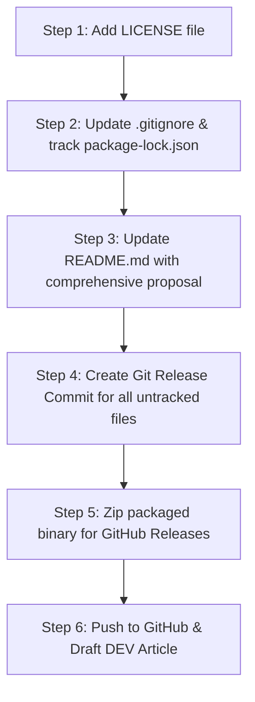

# SlothSort — Day 1 Release Action Plan

**Date:** October 20, 2026  
**Auditor:** Senior Release Engineer & Open-Source Maintainer  
**Target:** DEV Open-Source AI Challenge Week 3 ("Slow and Steady")  

This action plan categorizes all audit findings into prioritized, actionable tasks with concrete remediation steps, impact assessments, effort estimates, and testing requirements.

---

## Priority Classification Standard
- **P0 / P1 (Release Blockers):** Must be resolved before publishing the repository on GitHub or submitting to the challenge.
- **P2 (Submission Polish):** High-value improvements that should be completed before the submission deadline.
- **P3 (Post-Submission Enhancements):** Non-blocking polish items and roadmap features for future releases.

---

## 1. P0 / P1 — Must Fix Before Public Submission

### Issue 1.1: Entire Core Electron Application Untracked in Git
- **Severity:** **P0 (Critical Blocker)**
- **File / Path:** `src/main/`, `src/renderer/`, `test/`, `scripts/`, `artifacts/`, `tsconfig.node.json`, `vite.config.ts`
- **Evidence:** `git status --short --branch` lists all core application directories as untracked (`??`). Only the Phase 1 CLI prototype is committed.
- **User / Judge Impact:** If pushed to GitHub now, visitors and judges will see only the Phase 1 prototype; the entire desktop application and test suites will be missing.
- **Recommended Minimal Fix:**
  1. Verify all untracked files are clean and intended for release.
  2. Stage all working tree files:
     ```powershell
     git add src/ test/ scripts/ artifacts/ package.json tsconfig.json tsconfig.node.json vite.config.ts .gitignore
     ```
  3. Create a clean, comprehensive release commit:
     ```powershell
     git commit -m "feat: complete SlothSort desktop MVP with local Ollama inference, approval gate, undo engine, and Phase 3B validation"
     ```
- **Estimated Effort:** 10 minutes.
- **Rebuilding / Retesting Required:** No rebuild needed. Run `npm test` after committing to confirm clean working tree.

---

### Issue 1.2: Missing Open-Source `LICENSE` File
- **Severity:** **P1 (Legal Blocker)**
- **File / Path:** `LICENSE` (repository root)
- **Evidence:** `Test-Path LICENSE` returns `False`. No license file exists in the repository root.
- **User / Judge Impact:** Repositories without a license file default to "All Rights Reserved" under copyright law, disqualifying the project from open-source hackathons.
- **Recommended Minimal Fix:**
  Create a standard MIT License file at `LICENSE` matching the declaration in `package.json`:
  ```text
  MIT License

  Copyright (c) 2026 SlothSort Contributors

  Permission is hereby granted, free of charge, to any person obtaining a copy...
  ```
- **Estimated Effort:** 2 minutes.
- **Rebuilding / Retesting Required:** None.

---

### Issue 1.3: `README.md` Is Outdated and Frozen in Phase 1
- **Severity:** **P1 (Submission Blocker)**
- **File / Path:** `README.md`
- **Evidence:** `README.md` only documents the Phase 1 prototype and benchmark, with no mention of the desktop GUI, review queue, approval system, undo engine, or packaged executable.
- **User / Judge Impact:** Anyone reading the repository will think the desktop application was never built.
- **Recommended Minimal Fix:**
  Replace `README.md` with the comprehensive proposal provided in [`day-1-readme-proposal.md`](./day-1-readme-proposal.md), covering:
  - Desktop overview with screenshots.
  - Clear Ollama and `gemma3:4b` setup guide.
  - Step-by-step usage guide (Scan -> Review -> Approve -> Execute -> Undo).
  - Safety guarantees and Windows path constraints.
  - CPU inference latency expectations and SmartScreen notes.
  - Developer commands (`npm test`, `npm run build`, `npm run package`).
- **Estimated Effort:** 15 minutes.
- **Rebuilding / Retesting Required:** None.

---

## 2. P2 — Worthwhile Before the Deadline

### Issue 2.1: `package-lock.json` Is Gitignored
- **Severity:** **P2 (Dependency Hygiene)**
- **File / Path:** `.gitignore` (line 3)
- **Evidence:** Line 3 of `.gitignore` explicitly lists `package-lock.json`.
- **User / Judge Impact:** Developers and judges cloning the repository will run `npm install` without locked versions, which can lead to version drift or installation errors.
- **Recommended Minimal Fix:**
  1. Remove `package-lock.json` from `.gitignore`.
  2. Run `npm install --package-lock-only` to ensure lockfile is up to date.
  3. Commit `package-lock.json` to Git.
- **Estimated Effort:** 5 minutes.
- **Rebuilding / Retesting Required:** Run `npm test` to verify.

---

### Issue 2.2: Packaged Build Exists Only as Loose Unpacked Directory
- **Severity:** **P2 (Distribution Polish)**
- **File / Path:** `dist/package/win-unpacked/`
- **Evidence:** `dist/package/win-unpacked` contains the loose executable and supporting DLLs, but no single ZIP archive exists for user download.
- **User / Judge Impact:** Judges who want to test the binary without cloning and compiling from source cannot easily download a single file.
- **Recommended Minimal Fix:**
  Create a zipped release bundle for GitHub Releases:
  ```powershell
  Compress-Archive -Path "dist\package\win-unpacked\*" -DestinationPath "dist\package\SlothSort-v0.1.0-win-x64.zip" -CompressionLevel Optimal
  ```
  Upload `SlothSort-v0.1.0-win-x64.zip` to a GitHub Release draft.
- **Estimated Effort:** 5 minutes.
- **Rebuilding / Retesting Required:** No rebuild needed (zips existing verified binary).

---

### Issue 2.3: Prepare DEV Submission Post Article Draft
- **Severity:** **P2 (Challenge Submission)**
- **File / Path:** `artifacts/day-1-release-audit/dev-post-draft.md` (or article editor)
- **Evidence:** DEV Challenge requires a published post detailing the open-source AI project.
- **User / Judge Impact:** Without the DEV article, the submission is incomplete.
- **Recommended Minimal Fix:**
  Draft the article focusing on the "Slow and Steady" theme:
  - **Hook:** Why cluttered folders cause anxiety and why sending file metadata to the cloud is a privacy nightmare.
  - **The Solution:** A local-first, privacy-respecting file organizer powered by `gemma3:4b` on CPU.
  - **Why "Slow and Steady":** Deliberate batching, untrusted model outputs, strict cryptographic approvals, 1-click reversible undo, and journal recovery.
  - **Code Highlights:** Walk through the validation engine, Electron IPC isolation, and atomic file move engine.
  - **Screenshots:** Embed the 10 screenshots from Phase 3B.
- **Estimated Effort:** 45 minutes.
- **Rebuilding / Retesting Required:** None.

---

## 3. P3 — Post-Submission Enhancements

### Issue 3.1: Windows Code Signing (SmartScreen Advisory)
- **Severity:** **P3 (Packaging Polish)**
- **Component:** `electron-builder` configuration
- **Evidence:** Unsigned executable triggers Windows Defender SmartScreen "Unknown Publisher" advisory.
- **Impact:** Users must click "More info" -> "Run anyway".
- **Recommended Fix:** Obtain an Authenticode certificate and configure `win.certificateFile` or GitHub Actions SignTool for subsequent minor releases (v0.2.0+).
- **Estimated Effort:** Requires external certificate purchase. Can wait.

---

### Issue 3.2: Taskbar Progress Indicator for Batch Inference
- **Severity:** **P3 (UX Polish)**
- **Component:** `src/main/main.ts`
- **Evidence:** When the window is minimized during a long batch inference, no progress is visible on the Windows taskbar icon.
- **Recommended Fix:** Connect queue progress events to `mainWindow.setProgressBar(completed / total)`.
- **Estimated Effort:** 30 minutes. Can wait for v0.2.0.

---

## 4. Execution Sequence Summary


